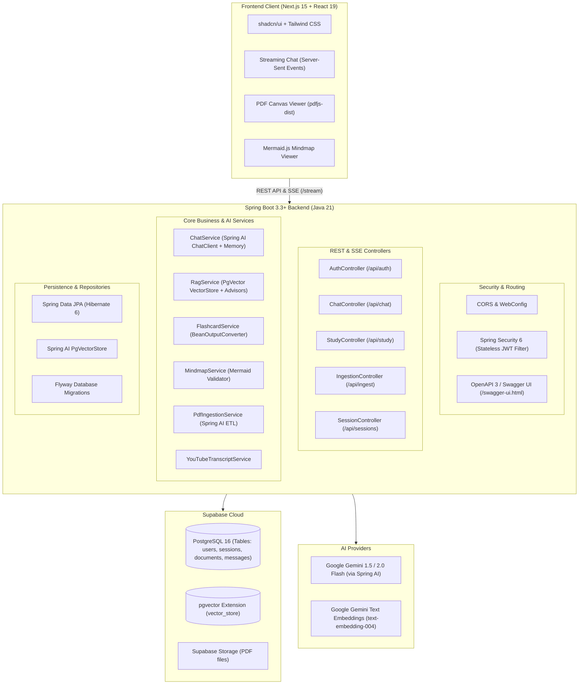

# Learnability Pro - Master Implementation & Migration Plan

> [!NOTE]
> **Implementation Status: Completed (Phases 1 - 6 Finished & Verified)**
> - **Backend**: Java 21 LTS, Spring Boot 4.1.2, Spring AI 2.0.2, PostgreSQL / Flyway / pgvector, Spring Security 6 stateless JWT, OpenAPI 3.2.0.
> - **Frontend**: Next.js 15, React 19, Tailwind CSS, Lucide icons, Mermaid.js, Zustand, TanStack Query.
> - **Verification**: 100% test suite passing (6/6 unit/slice tests), successful Next.js production build (`next build`).

## Project Overview
**Learnability Pro** is an enterprise-grade AI-powered multimodal learning platform built with **Java 21, Spring Boot 3.3+, Spring AI, and Supabase (PostgreSQL + pgvector)**, accompanied by a modern **Next.js 15 (React 19, Tailwind CSS, shadcn/ui)** client.

The application ingests study materials (PDF documents, YouTube videos/transcripts) and provides:
1. **Interactive AI Tutor Chat**: Streaming Q&A with grounded retrieval using Spring AI's RAG and vector search (`/learn`).
2. **Active Recall & Revision**: Adaptive testing, summaries, and comprehension drills (`/revise`).
3. **Structured Flashcard Generation**: Strongly-typed flashcard decks via Spring AI `BeanOutputConverter` (`/flashcard`).
4. **Visual Mindmap & Diagram Synthesis**: Validated Mermaid.js concept trees and flowcharts (`/diagram`).
5. **Session & Document History**: Persistent user sessions and document metadata in Supabase PostgreSQL (`/dashboard`).

---

## Architecture Blueprint



---

## Tech Stack Specification

* **Repository Layout**: Clean Monorepo containing:
  - `backend/`: Java 21 / 25 LTS, Spring Boot 4.1.2, Spring AI 2.0.2, Maven
  - `frontend/`: Next.js 16.4.5 (React 19.3.1, Tailwind CSS 4.3.5, shadcn/ui)
* **Authentication**: **Custom Spring Security 6** with stateless JWT authentication (`io.jsonwebtoken:jjwt-api:0.13.0`), custom `UserDetailsService`, password hashing with `BCryptPasswordEncoder`, and role-based endpoint protection.
* **Runtime**: Java 21 LTS or Java 25 LTS (Virtual Threads enabled via `spring.threads.virtual.enabled=true`)
* **Framework**: **Spring Boot 4.1.2** (`spring-boot-starter-web`, `spring-boot-starter-data-jpa`, `spring-boot-starter-security`, `spring-boot-starter-validation`)
* **AI Engine**: **Spring AI 2.0.2** (`org.springframework.ai:spring-ai-bom:2.0.2`) with Google Gemini integration (chat models + `text-embedding-004`)
* **Vector Store**: `spring-ai-pgvector-store-spring-boot-starter`
* **Database**: Supabase PostgreSQL 16 with `pgvector` extension enabled for relational and vector data (`org.postgresql:postgresql:42.7.14`)
* **Migration**: **Flyway DB 13.12.0** (`flyway-core` + `flyway-database-postgresql`)
* **API Documentation**: **SpringDoc OpenAPI 3.2.0** (`org.springdoc:springdoc-openapi-starter-webmvc-ui:3.2.0`) with Swagger UI at `/swagger-ui.html`
* **Frontend Core**: **Next.js 16.4.5**, **React 19.3.1**, **Tailwind CSS 4.3.5**, **Lucide Icons 1.70.0**, **Mermaid 12.3.0**, **Zustand 5.1.0**, **TanStack Query 5.107.1**
* **Build Tool**: Apache Maven (`pom.xml` with Maven Wrapper `mvnw`)

---

## Database Schema (PostgreSQL + pgvector)

### 1. Relational Tables (`V1__initial_schema.sql`)
```sql
CREATE EXTENSION IF NOT EXISTS "uuid-ossp";
CREATE EXTENSION IF NOT EXISTS "vector";

-- Users
CREATE TABLE users (
    id UUID PRIMARY KEY DEFAULT uuid_generate_v4(),
    email VARCHAR(255) NOT NULL UNIQUE,
    password_hash VARCHAR(255),
    name VARCHAR(255),
    provider VARCHAR(50) DEFAULT 'local',
    created_at TIMESTAMP WITH TIME ZONE DEFAULT CURRENT_TIMESTAMP,
    updated_at TIMESTAMP WITH TIME ZONE DEFAULT CURRENT_TIMESTAMP
);

-- Sessions
CREATE TABLE study_sessions (
    id UUID PRIMARY KEY DEFAULT uuid_generate_v4(),
    user_id UUID NOT NULL REFERENCES users(id) ON DELETE CASCADE,
    title VARCHAR(255) NOT NULL,
    session_type VARCHAR(50) NOT NULL, -- 'LEARN', 'REVISE', 'FLASHCARD', 'DIAGRAM'
    context_type VARCHAR(50) NOT NULL, -- 'PDF', 'YOUTUBE', 'TOPIC'
    source_url TEXT,
    context_text TEXT,
    created_at TIMESTAMP WITH TIME ZONE DEFAULT CURRENT_TIMESTAMP,
    updated_at TIMESTAMP WITH TIME ZONE DEFAULT CURRENT_TIMESTAMP
);

-- Chat Messages
CREATE TABLE chat_messages (
    id UUID PRIMARY KEY DEFAULT uuid_generate_v4(),
    session_id UUID NOT NULL REFERENCES study_sessions(id) ON DELETE CASCADE,
    sender VARCHAR(20) NOT NULL, -- 'USER', 'ASSISTANT', 'SYSTEM'
    content TEXT NOT NULL,
    created_at TIMESTAMP WITH TIME ZONE DEFAULT CURRENT_TIMESTAMP
);

-- Flashcard Decks & Cards
CREATE TABLE flashcard_decks (
    id UUID PRIMARY KEY DEFAULT uuid_generate_v4(),
    session_id UUID NOT NULL REFERENCES study_sessions(id) ON DELETE CASCADE,
    topic VARCHAR(255) NOT NULL,
    created_at TIMESTAMP WITH TIME ZONE DEFAULT CURRENT_TIMESTAMP
);

CREATE TABLE flashcards (
    id UUID PRIMARY KEY DEFAULT uuid_generate_v4(),
    deck_id UUID NOT NULL REFERENCES flashcard_decks(id) ON DELETE CASCADE,
    question TEXT NOT NULL,
    answer TEXT NOT NULL,
    hint TEXT,
    mastery_level INT DEFAULT 0
);

-- Mindmaps / Diagrams
CREATE TABLE diagrams (
    id UUID PRIMARY KEY DEFAULT uuid_generate_v4(),
    session_id UUID NOT NULL REFERENCES study_sessions(id) ON DELETE CASCADE,
    diagram_type VARCHAR(50) DEFAULT 'MERMAID',
    title VARCHAR(255),
    mermaid_code TEXT NOT NULL,
    explanation TEXT,
    created_at TIMESTAMP WITH TIME ZONE DEFAULT CURRENT_TIMESTAMP
);
```

### 2. Spring AI Vector Store Table (`vector_store`)
```sql
CREATE TABLE IF NOT EXISTS vector_store (
    id UUID DEFAULT uuid_generate_v4() PRIMARY KEY,
    content TEXT,
    metadata JSON,
    embedding VECTOR(768) -- Matches Gemini text-embedding-004 dimension
);

CREATE INDEX IF NOT EXISTS vector_store_hnsw_idx 
ON vector_store USING HNSW (embedding vector_cosine_ops);
```

---

## Detailed Step-by-Step Implementation Roadmap

### Phase 1: Environment & Project Scaffolding
- [x] **1.1 Java 21 & Maven Installation**:
  - Install Temurin / Corretto Java 21 via `mise install java@corretto-21` and set local version.
  - Install Maven or generate `mvnw` (Maven Wrapper).
- [x] **1.2 Directory Structure**:
  - Organize into clean monorepo:
    - `backend/` (Spring Boot 4.1.2 + Spring AI 2.0.2 + Maven)
    - `frontend/` (Next.js 15 Client)
- [x] **1.3 Backend `pom.xml` Dependencies**:
  - `spring-boot-starter-parent`: **`4.1.2`**
  - `spring-ai-bom`: **`2.0.2`** (`spring-ai-starter-model-google-genai` + `spring-ai-starter-vector-store-pgvector` + `spring-ai-vector-store-advisor` + `spring-ai-pdf-document-reader`)
  - `spring-boot-starter-web`, `spring-boot-starter-data-jpa`, `spring-boot-starter-security`, `spring-boot-starter-validation`.
  - Database: `org.postgresql:postgresql:42.7.14`, `org.flywaydb:flyway-core:13.12.0`, `org.flywaydb:flyway-database-postgresql:13.12.0`.
  - JWT Security: `io.jsonwebtoken:jjwt-api:0.13.0`, `io.jsonwebtoken:jjwt-impl:0.13.0`, `io.jsonwebtoken:jjwt-jackson:0.13.0`.
  - API Docs: `org.springdoc:springdoc-openapi-starter-webmvc-ui:3.2.0`.
  - `lombok` for boilerplate reduction.
- [x] **1.4 Application Configuration (`application.yml`)**:
  - Profiles for `local` (H2 / local Postgres) and `prod` (Supabase Postgres).
  - Gemini API key configuration and vector dimensions.
  - Virtual threads toggle: `spring.threads.virtual.enabled: true`.

### Phase 2: Domain Modeling & Persistence Layer
- [x] **2.1 Flyway Database Migrations**:
  - Create `V1__init_schema.sql` with tables for users, study sessions, messages, flashcards, diagrams.
  - Configure `vector` extension and vector indexing.
- [x] **2.2 JPA Entities**:
  - Create `User`, `StudySession`, `ChatMessage`, `FlashcardDeck`, `Flashcard`, `Diagram` entities.
- [x] **2.3 Spring Data JPA Repositories**:
  - Create repositories with custom query methods (e.g. `findByUserIdOrderByUpdatedAtDesc`).
- [x] **2.4 VectorStore Bean Setup**:
  - Configure `PgVectorStore` with `JdbcTemplate` and embedding client.

### Phase 3: Core AI Services with Spring AI
- [x] **3.1 ChatService & Reactive Streaming**:
  - Build `ChatService` using `ChatClient.Builder`.
  - Add `ChatMemoryAdvisor` (with JDBC / in-memory session persistence) to retain multi-turn context.
  - Expose `/api/chat/stream` returning `Flux<ServerSentEvent<String>>` for real-time token streaming.
- [x] **3.2 RAG Pipeline (Retrieval-Augmented Generation)**:
  - Implement `RagService` using `QuestionAnswerAdvisor(vectorStore)`.
  - Filter embeddings by `sessionId` or `documentId` via vector metadata filters.
- [x] **3.3 Strongly-Typed Flashcard Generator**:
  - Define Java Records:
    ```java
    public record FlashcardDto(String question, String answer, String hint) {}
    public record FlashcardDeckDto(String topic, List<FlashcardDto> cards) {}
    ```
  - Use `BeanOutputConverter<FlashcardDeckDto>` in `FlashcardService` to guarantee 100% valid JSON without regex hacks.
- [x] **3.4 Mermaid Mindmap Generator**:
  - Implement `MindmapService` using `BeanOutputConverter` or strict structured prompt with syntax verification to produce clean, error-free Mermaid flowchart / mindmap code.

### Phase 4: Document & Media Ingestion Pipeline
- [x] **4.1 PDF Ingestion ETL**:
  - Implement `PdfIngestionService` utilizing Spring AI's `PagePdfDocumentReader`.
  - Segment text using `TokenTextSplitter(800, 350, 5, 10000, true)`.
  - Extract document title and key topics using `ChatClient`.
  - Push chunk embeddings into `VectorStore` with metadata tags (`userId`, `sessionId`, `sourceFileName`, `pageNumber`).
- [x] **4.2 YouTube Transcript Extractor**:
  - Implement `YouTubeTranscriptService` to fetch subtitles directly from YouTube (via clean HTTP / caption track parsing or Gemini multimodal URL ingestion) — **strictly avoiding heavy Windows binaries (`bin/*.exe`)**.
  - Summarize video chapters and ingest text into the session context.

### Phase 5: Security, REST Controllers & OpenAPI
- [x] **5.1 Spring Security & JWT**:
  - Implement `JwtTokenProvider`, `JwtAuthenticationFilter`, and `SecurityFilterChain`.
  - Protect all `/api/**` routes except `/api/auth/**`, `/swagger-ui/**`, and `/v3/api-docs/**`.
- [x] **5.2 REST Controllers**:
  - `AuthController`: register, login, refresh token, me.
  - `SessionController`: CRUD for study sessions and user history.
  - `ChatController`: SSE streaming chat endpoint and message retrieval.
  - `IngestionController`: Multipart PDF upload and YouTube URL ingestion endpoints.
  - `StudyController`: Endpoints to trigger flashcard and diagram generation.
- [x] **5.3 Global Exception Handling & RFC 7807**:
  - Create `@RestControllerAdvice` returning standard `ProblemDetail` responses for 400, 401, 404, 429, and 500 errors.
- [x] **5.4 Swagger / OpenAPI**:
  - Document all endpoints with `@Operation`, `@ApiResponse`, and request examples.

### Phase 6: Frontend Client Integration
- [x] **6.1 Next.js 15 Client Setup**:
  - Scaffold `frontend/` with Next.js 15, TypeScript, Tailwind CSS, and shadcn/ui.
  - Setup API client with `fetch` / Axios with JWT interceptor.
- [x] **6.2 Study Workspace (`/learn`)**:
  - Split view: Document preview (PDF / YouTube embed) on left, SSE streaming tutor chat on right.
- [x] **6.3 Flashcard Interactive Player (`/flashcard`)**:
  - 3D card flip animation, keyboard shortcuts (Space to flip, Arrow keys to navigate), score tracker.
- [x] **6.4 Interactive Mindmap (`/diagram`)**:
  - Pan/zoom SVG viewer for Mermaid diagrams with export options (SVG/PNG/Markdown).
- [x] **6.5 Session Dashboard (`/dashboard`)**:
  - Filter by session type, view past chats, resume study sessions.

---

## Instructions for Next Agent
When picking up this plan:
1. Verify Java 21 environment (`java -version`, `mvn -v`).
2. Scaffold `backend/` using Spring Initializr / Maven archetype with the exact dependencies listed in Phase 1.
3. Keep code strictly decoupled: Clean controllers, service interfaces, record DTOs, and Spring AI beans.
4. Test endpoints with standard Spring Boot test slices (`@WebMvcTest`, `@DataJpaTest`, `@SpringBootTest`).
