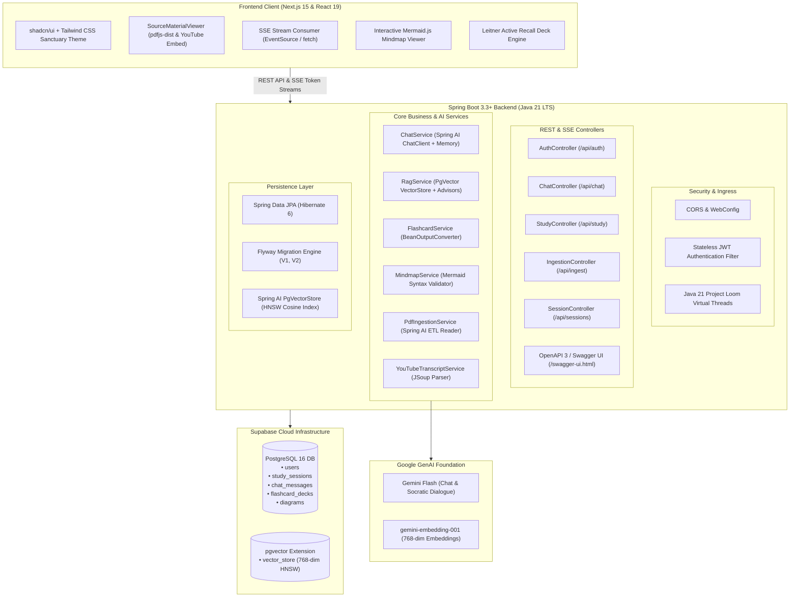

# 🧠 Learnability Pro

<div align="center">


<br/>

**Enterprise Multimodal AI Cognitive Learning Sanctuary & Knowledge Synthesis Platform**

[](https://openjdk.org/projects/jdk/21/)
[](https://spring.io/projects/spring-boot)
[](https://spring.io/projects/spring-ai)
[](https://nextjs.org/)
[](https://react.dev/)
[](https://supabase.com/)
[](https://tailwindcss.com/)
[](https://www.typescriptlang.org/)
[](LICENSE)

---

### 🌐 [**Visit Live Production Demo**](https://learnability.nironman.com)
**[https://learnability.nironman.com](https://learnability.nironman.com)**

*Transform dense academic textbooks, research papers, and lecture videos into deep comprehension, long-term retention, and structured active recall.*

---

</div>

## 📑 Table of Contents

- [Overview & Philosophy](#-overview--philosophy)
- [System Architecture](#-system-architecture)
- [Core Features & Learning Tools](#-core-features--learning-tools)
- [The Monastic Scholar Design System](#-the-monastic-scholar-design-system)
- [Tech Stack & Ecosystem](#-tech-stack--ecosystem)
- [Monorepo Project Structure](#-monorepo-project-structure)
- [Prerequisites & Environment Setup](#-prerequisites--environment-setup)
- [Local Development Guide](#-local-development-guide)
  - [Option 1: Split Terminal Runner (tmux - Recommended)](#option-1-split-terminal-runner-tmux---recommended)
  - [Option 2: Unified Concurrent Runner](#option-2-unified-concurrent-runner)
  - [Option 3: Manual Step-by-Step](#option-3-manual-step-by-step)
- [API & Streaming Endpoints](#-api--streaming-endpoints)
- [Database Schema & Migrations](#-database-schema--migrations)
- [Author & Credits](#-author--credits)
- [License](#-license)

---

## 💡 Overview & Philosophy

**Learnability Pro** is an AI-powered multimodal learning sanctuary engineered for university students, researchers, and self-directed learners tackling complex, high-density educational materials. 

Unlike conventional AI chat tools that return generic, detached summaries or hallucinate ungrounded facts, Learnability Pro couples **grounded retrieval-augmented generation (RAG with pgvector and verifiable citations)** with proven cognitive science learning primitives:

1. **Grounded Over Generative:** Every explanation, concept branch, and flashcard anchors strictly to verified source documents with clear provenance.
2. **Active Over Passive:** Replaces passive skimming with active recall drills, Leitner spaced repetition, and dynamic concept reconstruction.
3. **Cognitive Clarity:** The *Monastic Scholar* design system ensures distraction-free reading with 65–70ch measures, tranquil dark slate palette, and zero extraneous visual noise.
4. **Resilient Feedback Loops:** Real-time token streaming via Server-Sent Events (SSE), immediate syntax-validated Mermaid diagram rendering, and instant drill validation.

---

## 🏛 System Architecture

Learnability Pro is built as a cohesive monorepo uniting a high-performance **Java 21 / Spring Boot 3.3+ backend** with a reactive **Next.js 15 (React 19) client**, powered by **Spring AI**, **Google Gemini**, and **Supabase (PostgreSQL 16 + pgvector)**.



---

## ⚡ Core Features & Learning Tools

### 1. 💬 Interactive Socratic AI Tutor (`/learn`)
- **Server-Sent Events (SSE) Streaming:** Experience real-time token delivery with millisecond latency via `/api/chat/{sessionId}/stream`.
- **Grounded Vector Search (RAG):** Context is pulled dynamically from ingested source materials using Spring AI's `QuestionAnswerAdvisor` with session-level vector metadata filters.
- **Verifiable Citations:** Responses cite exact paragraphs, page numbers, and transcript timestamps, eliminating hallucinations.
- **Persistent Chat Memory:** Contextual window of preceding turns preserved using Spring AI `MessageWindowChatMemory`.

### 2. 📑 Multimodal Ingestion Pipeline (`/api/ingest`)
- **Academic PDF Ingestion:** Upload multi-page textbooks and research papers. Ingestion leverages Spring AI's PDF ETL pipeline to clean, chunk, and extract vector embeddings.
- **YouTube Lecture Transcripts:** Ingest educational videos and lecture series simply by pasting a URL. Transcripts and XML/HTML caption tracks are retrieved, parsed via JSoup, and vectorized into pgvector.
- **In-Browser Document & Video Studio:** Read source PDFs with text selection markers or watch lecture videos side-by-side with your AI tutor.

### 3. 🗂️ Structured Flashcards & Spaced Repetition (`/flashcard`)
- **Schema-Validated Generation:** Generates strongly-typed flashcard decks via Spring AI `BeanOutputConverter` (`FlashcardDeckDto`).
- **Active Recall Drills:** Flip cards to reveal hints and detailed explanations anchored to source passages.
- **Adaptive Mastery Tracking:** Integrated Leitner spaced repetition system updates card mastery levels (`NEW`, `LEARNING`, `MASTERED`) via `/api/study/flashcards/{cardId}/mastery`.

### 4. 🗺️ Visual Mindmap & Concept Synthesis (`/diagram`)
- **Automated Knowledge Graphs:** Synthesizes structured concept hierarchies and dependency flowcharts from dense study text.
- **Validated Mermaid.js Output:** Employs strict server-side validation to ensure clean, error-free Mermaid syntax.
- **Interactive Exploration:** Zoom, pan, and visually inspect interconnected topics, causal relationships, and sub-disciplines.

### 5. 🎯 Active Recall & Adaptive Revision Drills (`/revise`)
- **Targeted Socratic Challenge:** Prompts the learner to explain concepts in their own words, answer diagnostic questions, and identify logical fallacies.
- **Progress Tracking:** Tracks recall accuracy and pinpoints conceptual gaps that require re-reading.

### 6. 🏛️ Focus Sanctuary & Session Management (`/dashboard`)
- **Session Library:** Seamlessly organize study sessions across topics, textbooks, and video lectures.
- **Progress Telemetry:** Monitor card mastery percentages, total chat interactions, and learning hours.

---

## 🎨 The Monastic Scholar Design System

Learnability Pro departs from sensory-overloaded "IDE cockpit" interfaces with competing neon elements. Instead, it introduces **Monastic Scholar**: a tranquil cognitive sanctuary built for multi-hour focus sessions.

### Tri-Mode Study Studio
| Mode | Purpose | Experience |
|:---|:---|:---|
| **Focus Read** | Deep uninterrupted study | 100% serene reading canvas (optimal 65–70ch measure), zero peripheral noise, selection-driven contextual tools. |
| **Interrogate** | Socratic dialogue | Harmonious 2-column workbench pairing source material with an articulate, citation-grounded tutor. |
| **Active Recall** | Long-term memory drills | Full-focus spaced repetition deck with flip animations, keyboard hotkeys, and mastery telemetry. |

### Color Palette Restraint
- **Canvas:** Deep Obsidian Slate (`#0A0D14`) in dark mode; soft warm drafting slate (`#F8FAFC`) in light mode.
- **Surfaces:** `#111622` (quiet cards) and `#182032` (elevated overlays).
- **Rule Borders:** `#1E293B` (hairline dividers with zero visual distraction).
- **Primary Ink:** `#F8FAFC` (high-contrast, razor-sharp typography).
- **Body Ink:** `#CBD5E1` (comfortable, low-fatigue reading tone).
- **Accent Cyan:** `#38BDF8` (focus & active selection state).
- **Emerald Ground Truth:** `#34D399` (semantic source verification & citations).

---

## 🛠 Tech Stack & Ecosystem

### Backend Architecture
| Component | Technology | Description |
|:---|:---|:---|
| **Runtime & JDK** | **Java 21 LTS** | High-throughput concurrent execution using Project Loom Virtual Threads (`spring.threads.virtual.enabled: true`). |
| **Framework** | **Spring Boot 3.3+ (4.1.2 starter)** | Web, Data JPA, Security, Validation. |
| **AI Framework** | **Spring AI 2.0.2** | `ChatClient`, `ChatMemory`, `QuestionAnswerAdvisor`, `BeanOutputConverter`. |
| **LLM Provider** | **Google Gemini Flash** | Low-latency chat generation (`gemini-flash-lite-latest` / `gemini-1.5-flash`). |
| **Embedding Model** | **gemini-embedding-001** | 768-dimensional semantic embeddings for dense document retrieval. |
| **Vector Store** | **Supabase pgvector** | PostgreSQL `vector` extension with Cosine Distance and HNSW indexing. |
| **Relational Database** | **PostgreSQL 16** | Flyway-managed schema migrations (`V1__init_schema.sql`, `V2__enable_rls.sql`). |
| **Security** | **Spring Security 6 + JJWT** | Stateless JWT authentication, secure password hashing, and endpoint authorization. |
| **ETL & Parsing** | **Spring AI PDF Reader + JSoup** | Text extraction from multi-page PDFs and YouTube caption tracks. |
| **API Documentation** | **Springdoc OpenAPI 3.2.0** | Interactive Swagger UI at `/swagger-ui.html`. |

### Frontend Client
| Component | Technology | Description |
|:---|:---|:---|
| **Framework** | **Next.js 15 (App Router)** | Server and Client Components, API route proxying, and unbuffered SSE handling. |
| **UI Library** | **React 19** | Modern concurrent rendering and hooks. |
| **Styling** | **Tailwind CSS 3.4** | Custom Monastic Scholar color tokens, custom utilities, and responsive breakpoints. |
| **State Management** | **Zustand 5.0** | Lightweight client stores for active session, theme, and study state. |
| **Data Fetching** | **TanStack Query 5.66** | Server-state caching, invalidation, and optimistic updates. |
| **Diagrams & Math** | **Mermaid.js 11.4 + KaTeX** | Client-side visual graph rendering and LaTeX mathematical formula typesetting. |
| **PDF Rendering** | **pdfjs-dist 4.10** | High-fidelity canvas-based PDF viewing with page jumping and zoom controls. |
| **Icons & Typography** | **Lucide React + Inter** | Clean, minimalist iconography and humanist typography. |

---

## 📂 Monorepo Project Structure

```bash
learnabilityPro/
├── README.md                      # Comprehensive project documentation
├── PRODUCT.md                     # Product vision, principles, and audience
├── DESIGN.md                      # Monastic Scholar design system & typography specs
├── PLAN.md                        # Architectural roadmap & verification log
├── run.sh                         # Unified concurrent runner (colored logs, graceful shutdown)
├── run-tmux.sh                    # Split-terminal runner (tmux, Spring Boot top / Next.js bottom)
├── t3.json                        # T3 Code workspace configuration & script buttons
│
├── backend/                       # Java 21 / Spring Boot 3.3+ Backend
│   ├── pom.xml                    # Maven build configuration & Spring AI BOM
│   ├── mvnw / mvnw.cmd            # Maven wrapper binaries
│   └── src/
│       ├── main/
│       │   ├── java/com/learnabilitypro/learnability/
│       │   │   ├── LearnabilityApplication.java # Spring Boot main entry point
│       │   │   ├── config/        # AiConfig (ChatClient, VectorStore), OpenApiConfig
│       │   │   ├── controller/    # Auth, Chat (SSE), Ingestion, Session, Study
│       │   │   ├── domain/
│       │   │   │   ├── dto/       # Request/Response DTOs & BeanOutput schemas
│       │   │   │   ├── entity/    # JPA Entities (User, Session, Message, Flashcard, Diagram)
│       │   │   │   └── repository/# Spring Data JPA repositories
│       │   │   ├── exception/     # GlobalExceptionHandler & custom exceptions
│       │   │   ├── security/      # JwtFilter, JwtTokenProvider, SecurityConfig
│       │   │   └── service/       # RagService, ChatService, FlashcardService, MindmapService, etc.
│       │   └── resources/
│       │       ├── application.yml# Environment & profile configuration
│       │       └── db/migration/  # Flyway SQL migrations (V1 schema, V2 RLS)
│       └── test/                  # Controller, service, and security unit tests
│
└── frontend/                      # Next.js 15 / React 19 Frontend
    ├── package.json               # Dependencies, scripts, and package metadata
    ├── next.config.ts             # Next.js rewrites, headers, and asset config
    ├── tailwind.config.ts         # Sanctuary theme tokens, dark mode, typography
    ├── .env.example               # Frontend environment template
    ├── public/                    # Static assets & PDF.js worker
    └── src/
        ├── app/                   # App Router pages (/learn, /flashcard, /diagram, /dashboard)
        │   ├── layout.tsx         # Root layout with ThemeProvider and QueryClient
        │   ├── page.tsx           # Tri-Mode Study Studio primary interface
        │   └── globals.css        # Tailwind directives and CSS variables
        ├── components/            # Reusable UI primitives & study tools
        │   ├── SourceMaterialViewer.tsx # Split-pane PDF & YouTube viewer
        │   ├── MinimalPdfViewer.tsx     # Canvas-based PDF viewer
        │   ├── MarkdownRenderer.tsx     # KaTeX math & Markdown parser
        │   ├── ThinkingIndicator.tsx   # Real-time streaming AI indicator
        │   ├── SanctuaryHeader.tsx      # Top bar navigation & mode toggle
        │   └── GlobalCommandPalette.tsx # Cmd+K quick navigation palette
        └── lib/
            ├── api.ts             # Type-safe fetch client & SSE streaming helper
            └── thinkingWords.ts   # Cognitive status text rotation
```

---

## 🔧 Prerequisites & Environment Setup

### Required Tools
- **JDK 21** (e.g. Eclipse Temurin, OpenJDK, or Amazon Corretto)
- **Node.js 20+** and **pnpm** (or `npm`)
- **PostgreSQL 16** with **pgvector** enabled (or a free [Supabase](https://supabase.com) project)
- **Google Gemini API Key** (from [Google AI Studio](https://aistudio.google.com/))
- **tmux** *(optional, for split-terminal runner)*: `sudo apt install tmux` or `brew install tmux`

---

### Backend Environment Configuration
Configure your backend environment using environment variables or a local `.env` file in `backend/`:

| Variable | Default Value | Description |
|:---|:---|:---|
| `DATABASE_URL` | `jdbc:h2:mem:learnability;...` | PostgreSQL JDBC URL (e.g. `jdbc:postgresql://<supabase-host>:5432/postgres`) |
| `DATABASE_USER` | `sa` | PostgreSQL username (e.g. `postgres`) |
| `DATABASE_PASSWORD` | *(empty)* | PostgreSQL password |
| `GEMINI_API_KEY` | *(mock key)* | Google Gemini API key |
| `GEMINI_PROJECT_ID` | `learnability-pro-dev`| Google Cloud project identifier |
| `GEMINI_CHAT_MODEL` | `gemini-flash-lite-latest` | Model used for Socratic chat and active recall |
| `GEMINI_EMBEDDING_MODEL`| `gemini-embedding-001` | Model used for 768-dim embeddings |
| `JWT_SECRET` | *(built-in 256-bit key)* | Secret key for signing and verifying JWT tokens |
| `CORS_ALLOWED_ORIGINS`| `http://localhost:3000` | Comma-separated list of allowed frontend origins |
| `FLYWAY_ENABLED` | `false` (in-memory) / `true` (Supabase) | Run Flyway database migrations on startup |

> [!NOTE]
> If `DATABASE_URL` is omitted, the backend automatically initializes an **in-memory H2 database** and fallback vector store, allowing you to run and test immediately without configuring a database.

---

### Frontend Environment Configuration
Copy the template to `.env.local` inside the `frontend/` directory:

```bash
cp frontend/.env.example frontend/.env.local
```

Edit `frontend/.env.local`:
```env
# Backend server URL for Next.js internal API proxying
BACKEND_URL=http://localhost:8080

# Direct backend API URL for client-side fetches and unbuffered SSE streaming
NEXT_PUBLIC_BACKEND_URL=http://localhost:8080/api

# Public URL of the frontend application
NEXT_PUBLIC_APP_URL=http://localhost:3000

# Next.js port
PORT=3000
```

---

## 🚀 Local Development Guide

### Option 1: Split Terminal Runner (tmux - Recommended)
The fastest way to launch the entire stack in a single terminal with live split panes (Spring Boot on top, Next.js on bottom):

```bash
./run-tmux.sh
# or
./run.sh tmux
```

- **Mouse Scrolling & Clicking:** Enabled across both panes.
- **Shutdown:** Press `Ctrl + C` in either pane or detach with `Ctrl + B`, then `d`.

---

### Option 2: Unified Concurrent Runner
Runs both services concurrently in a single terminal with colored output prefixes (`[backend]` in cyan, `[frontend]` in magenta) and graceful child process termination:

```bash
./run.sh
```

Press `Ctrl + C` once to gracefully shut down both services.

---

### Option 3: Manual Step-by-Step

#### 1. Start the Spring Boot Backend
```bash
cd backend
./mvnw clean spring-boot:run
```
The backend starts on `http://localhost:8080`.
- Swagger UI: `http://localhost:8080/swagger-ui.html`
- OpenAPI JSON: `http://localhost:8080/v3/api-docs`

#### 2. Start the Next.js Frontend
In a new terminal:
```bash
cd frontend
pnpm install # or npm install
pnpm dev     # or npm run dev
```
The frontend starts on `http://localhost:3000`. Open your browser and navigate to `http://localhost:3000`.

---

## 📡 API & Streaming Endpoints

### Authentication (`/api/auth`)
| Method | Endpoint | Description |
|:---|:---|:---|
| `POST` | `/api/auth/register` | Register new user account with email and password |
| `POST` | `/api/auth/login` | Authenticate credentials and receive JWT bearer token |
| `GET` | `/api/auth/me` | Fetch currently authenticated user profile |

### Multimodal Ingestion (`/api/ingest`)
| Method | Endpoint | Description |
|:---|:---|:---|
| `POST` | `/api/ingest/pdf` | Multipart upload for PDF documents; extracts text, chunks, and creates embeddings |
| `POST` | `/api/ingest/youtube` | Parses YouTube URL, fetches video captions via JSoup, and indexes into pgvector |
| `GET` | `/api/ingest/pdf/{sessionId}` | Serves raw PDF file bytes for in-browser canvas rendering |
| `GET` | `/api/ingest/pdf/{sessionId}/status` | Checks ingestion indexing status and vector readiness |

### Interactive Chat & Streaming (`/api/chat`)
| Method | Endpoint | Description |
|:---|:---|:---|
| `GET` | `/api/chat/{sessionId}/stream?message=...` | **Server-Sent Events (SSE)** endpoint streaming real-time token responses with RAG citations |
| `POST` | `/api/chat/{sessionId}/send` | Synchronous chat message submission and AI response retrieval |
| `GET` | `/api/chat/{sessionId}/messages` | Retrieves message history for the given study session |

### Study Primitives & Active Recall (`/api/study`)
| Method | Endpoint | Description |
|:---|:---|:---|
| `GET` | `/api/study/{sessionId}/flashcards/readiness` | Checks if session has sufficient ingested context for card generation |
| `POST` | `/api/study/{sessionId}/flashcards` | Generates strongly-typed flashcard deck using Spring AI `BeanOutputConverter` |
| `GET` | `/api/study/{sessionId}/flashcards` | Fetches saved flashcard decks for the session |
| `PUT` | `/api/study/flashcards/{cardId}/mastery` | Updates Leitner spaced repetition status (`NEW`, `LEARNING`, `MASTERED`) |
| `POST` | `/api/study/{sessionId}/diagram` | Synthesizes validated Mermaid.js mindmap / concept diagram |
| `GET` | `/api/study/{sessionId}/diagrams` | Retrieves saved diagrams for the session |

### Session Management (`/api/sessions`)
| Method | Endpoint | Description |
|:---|:---|:---|
| `POST` | `/api/sessions` | Create a new study session (`PDF`, `YOUTUBE`, or `TOPIC`) |
| `GET` | `/api/sessions` | List all active study sessions for the authenticated user |
| `GET` | `/api/sessions/{id}` | Retrieve session details, metadata, and context |
| `DELETE` | `/api/sessions/{id}` | Delete session and cascade purge vector embeddings |

---

## 🗄 Database Schema & Migrations

Database migrations are managed via **Flyway** under `backend/src/main/resources/db/migration/`:

- **`V1__init_schema.sql`**:
  - Initializes extensions: `uuid-ossp` and `vector`.
  - Creates tables: `users`, `study_sessions`, `chat_messages`, `flashcard_decks`, `flashcards`, `diagrams`.
  - Sets up the `vector_store` table with 768 dimensions and an **HNSW index** with cosine distance optimization (`vector_cosine_ops`).
- **`V2__enable_rls.sql`**:
  - Configures PostgreSQL Row Level Security (RLS) policies for user data protection in Supabase.

---

## 👤 Author & Credits

**Niranjan Dabhade**
- 🌐 Website: [nironman.com](https://nironman.com)
- 🐙 GitHub: [@NIRONMAN](https://github.com/NIRONMAN)
- 💼 Project Live Demo: [https://learnability.nironman.com](https://learnability.nironman.com)

---

## 📄 License

This project is licensed under the [MIT License](LICENSE).
